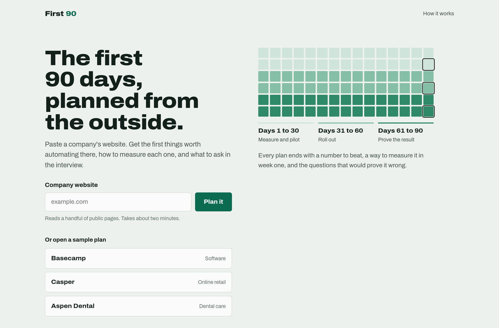
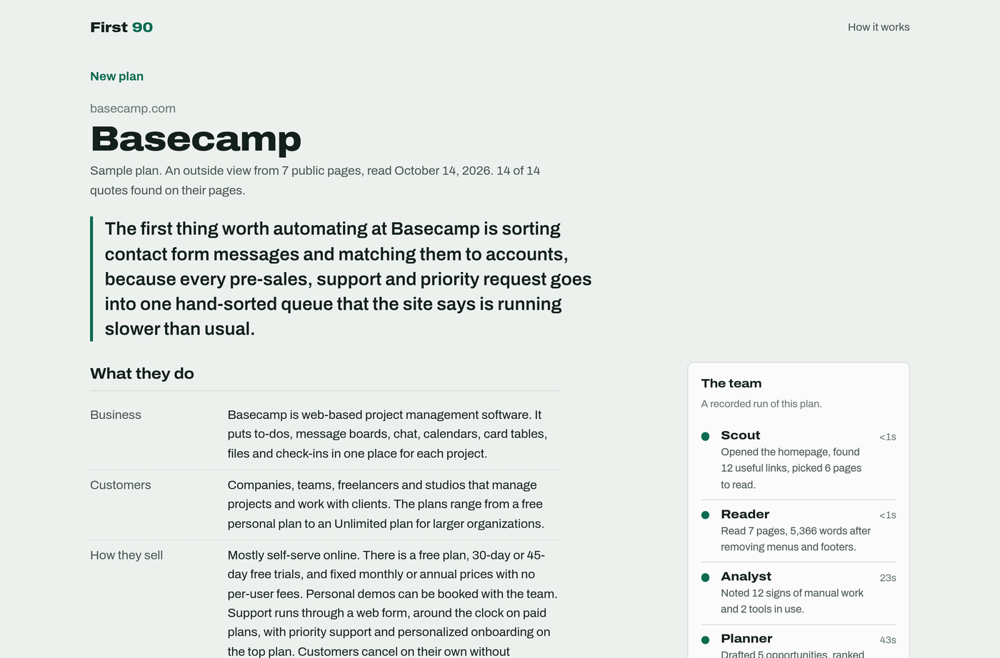

# First 90

Paste a company's website. Get the first things worth automating there, how to measure each one, and what to ask in the interview.

**Live:** https://first90.meetdominic.me



## What a plan gives you

- **The headline.** One sentence: the first thing worth automating, and why.
- **The plan.** Three to five ranked opportunities, each with the problem, the approach, a metric, a week-one baseline, a 90-day target and milestones at day 30, 60 and 90.
- **Assumptions and questions.** What the plan takes for granted, and the interview question that would confirm or kill each idea.
- **Signs of manual work.** Every claim quotes the page it came from, and the quote is checked.



## The team

| Step | Who | What it does |
|---|---|---|
| Scout | code | Opens the homepage and picks up to six telling pages (about, pricing, support, careers, returns, booking). |
| Reader | code | Turns them into plain text and drops lines that repeat across pages (menus, footers). |
| Analyst | Claude | Notes concrete signs of manual work, each with an exact quote and page number. |
| Planner | Claude | Ranks 3 to 5 opportunities with measures and milestones. |
| Skeptic | Claude | Challenges each idea, cuts generic ones, writes the question that would prove it wrong. |
| Checker | code | Finds every quote on its page and marks any that are not there. |

Each step streams to the page as it finishes (server-sent events). Sample plans are recorded runs of the same pipeline and can be replayed with their real timings.

## Run it

```bash
npm install
npm run build
npx wrangler dev --var MOCK_ENGINE:1   # stand-in model and a stand-in site (example.com), no API key needed
```

Live plans need Worker secrets: `ANTHROPIC_API_KEY`, and `ANTHROPIC_WORKSPACE_ID` for organisation-level keys. Without a key the samples work and live plans show as paused.

## Tests

```bash
npm test        # site reading, the pipeline, the stream, limits, and the samples (current prompts, every quote found, house style)
npm run e2e     # phone (390x844, 360x640) and desktop walkthrough in light and dark, against a running dev server
```

## License

MIT
